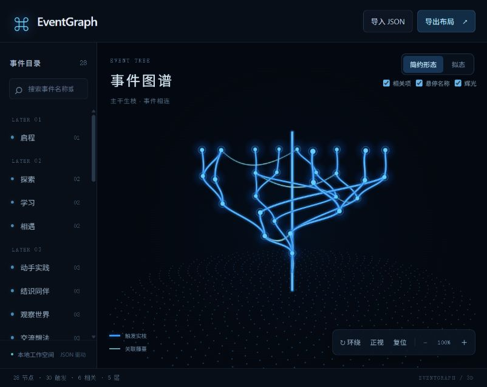
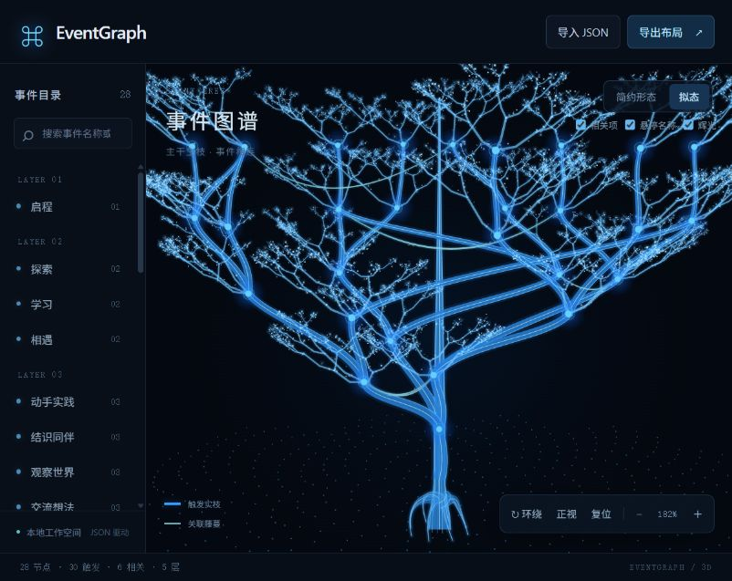

# 三维事件查看器

在项目根目录运行（Python 3.10+，无需安装前端依赖）：

```bash
python3 -m eventgraph.viewer examples/branching.json --port 8765
```

浏览器打开 `http://127.0.0.1:8765`，终端 Ctrl+C 停止。将文件参数替换为自己的 version 2 事件 JSON（兼容导入 version 1）。格式见 [JSON 解析与布局](json-layout.md)。服务仅监听本机，浏览器资源均随包提供，可离线使用。



## 画面与语义

目前有两种可切换的树形外观，默认采用简约形态，均保留笔直主干。原生 Canvas 将服务端展开树冠后的 XYZ 坐标透视投影到屏幕，旋转改变相机，不改变数据或先后约束；花瓣与环形排位已移除。

分枝遵循触发关系：没有任何触发前置的事件从树干延伸，包括独立事件、只有关联输入的事件、仅因时间窗口而处于较高层的事件。有触发前置的事件只从对应触发节点延伸；多个前置节点的所有真实连接都保留。关联项不决定分枝归属。若根节点恰在主干轴线上，它位于主干上；其他根节点通过细枝接到主干。

树干及通向根节点的支撑枝是视觉结构，不添加事件或业务依赖，不写入导出的业务连接。节点 Y 高度仍表示先后层级，具体时间窗口在详情中显示；已移除时间箭头和文字标记。

简约形态的触发项使用加粗的蓝色实体枝身与窄高光，基准宽度 3.4px 并随透视略作调整；主干为 5px 实体加高光。关联项使用约 1.45px 的青蓝连续细带与柔和窄高光，默认主体透明度为 0.9。曲线沿端点方向平滑下垂并向树干外侧轻弯，取代反复摆动；双向关联使用相邻弧线，真实端点与连接完整保留。藤身宽度平滑变化，使用一次填充避免分段接缝发亮；拟态每条藤蔓附有两个小叶芽，简约形态不加叶芽。自关联绘制为下垂闭环。选中时进一步提高可读性。关闭辉光仍保留枝身和关联轨迹。两者默认可见，选中节点后显示直接业务连接的方向箭头并淡化其他部分。关闭“相关项”后，仍显示所选节点的直接关联。导出保存服务端生成的实际布局坐标；重新导入按事件定义重新布局。

节点名称默认隐藏，鼠标靠近节点（约 28px 范围）时只显示最近节点的名称，移开即隐藏；选中节点也不常驻名称。两种形态采用相同规则，可从列表搜索和选取，触屏点击节点或列表查看详情。示例包含 28 个节点、30 条触发连接、6 条相关连接和 5 层。

## 树冠展开

查看器使用 `spread_canopy` 在通用约束布局之后展开 XZ 坐标：按触发分枝分配不同方位，随分枝深度向外伸展；除唯一根节点外，为主干轴线留空。层内仍使用六角网格席位保证最小间距，Y 与 rank 保持不变。

展开后增加关联邻近优化：将有关联的节点向彼此附近调整，缩短藤蔓，同时约束节点离原位置的偏移、树冠半径和触发枝方向。按无向节点对去重计算吸引力，双向或多端口关联不会重复加权，但所有真实连线仍保留。最多进行 10 轮局部调整，不改变 Y、层级或分枝归属，不占用已有席位和主干轴线。它是软偏好，不保证所有关联节点都相邻或所有视角都无交叉。

多前置节点仅为几何排位选择一个确定的主父节点，其他真实触发连接完整保留；相关项不决定分枝。多根和只有相关输入的节点分散到主干四周。两种形态与导出均使用展开后的实际坐标。库的通用 `layout_graph` 及 CLI 保留原布局；查看器每次导入重新排位，暂不保证增删后的增量位置稳定。窄屏增加水平留白以容纳树冠末梢。

## 两种形态

- **简约形态**：保留原有电蓝色凝实触发枝、清晰的关联藤蔓和清晰节点，方便阅读关系。
- **拟态**：参考用户提供的 [紫色发光树](concepts/natural-tree-reference.png)，形状参考保持不变，配色按用户最新要求统一为简约蓝光。加入有体积的渐细主干、树皮纤维、外扩根部、递归装饰小枝、发光树冠及起伏的蓝色点阵地面。

通过画布右上方的“简约形态 / 拟态”按钮切换，保留当前选择、相机和显示选项；导入新图也沿用当前形态，刷新页面默认回到简约形态。两种形态共用事件位置与业务连接，拟态装饰小枝不参与选择、触发校验或 JSON 导出。装饰由事件 ID 确定，旋转时保持三维一致；首次使用拟态时生成并缓存，导入后重建。大图对装饰采样降级，最多生成 4,500 条装饰枝和 18,000 个光点；这不是大图帧率保证。



### 拟态枝桠的粗细连续性

枝桠不再按每条连接独立设置固定起止粗细。每个事件节点共享一个交接半径，由去重后的触发后继关系反向计算；同一节点所有入枝末端与出枝起点使用完全相同的半径。粗细在连接内部平滑变化，端点处变化率为零，减少分段接缝。相关项和重复结果端口不增加枝重，多前置汇合保留全部真实连接。

主干使用连续粗细曲线，根支撑起点共享该高度的主干半径；主干几何包含实际接枝高度。节点处填补不同曲线朝向造成的细小缝隙，去掉枝段端面的亮边。分枝权重及半径设有上限，避免复杂汇合图导致枝身无限变粗。这是显示规则，不改变业务语义。

## 操作

- 拖动旋转；Shift 拖动或右键拖动平移；滚轮或双指捏合缩放。
- 点击节点或左侧目录查看时间窗口、角色、结果及输入/输出连接；点击详情中的关联项跳转选择。
- “环绕”开启或暂停自动旋转，“正视”与“复位”重置相机，减号/加号缩放。
- 画布获得键盘焦点后，方向键旋转，`+` / `-` 缩放，Home 复位，Escape 取消选择。
- 搜索按事件名称或 ID 筛选目录；悬停名称、辉光和相关项显示可以独立切换。

## 导入与导出

“导入 JSON”支持选文件或粘贴。原始事件 JSON 经底层解析、校验与布局成功后替换当前图；失败保留原图。也可重新导入查看器导出的 `{graph, layout}` 文件，其中 `graph` 重新校验并布局，旧坐标不作为事实来源。

“导出布局”下载 `.scene.json`，包含当前规范化 `graph` 与 `layout`。导入数据只保存在当前浏览器页面内，刷新恢复启动时的文件内容；服务不写回原文件、不修改其他窗口。当前尚无可视化节点编辑、自动保存或执行历史展示。

## 结构与边界

- `eventgraph/viewer.py`：静态资源、本地场景读取与解析布局 API。
- `eventgraph/web/app.js`：界面、选择状态、导入与导出。
- `eventgraph/web/renderer.js`：相机投影、曲线、节点、标签及指针操作。
- `eventgraph/web/styles.css`：桌面三栏与窄屏布局。

每次导入最多 2 MiB、3,000 个事件、12,000 条连接；这是输入保护范围，不是流畅帧率保证。查看器使用 5.0 的节点间距，底层布局接口默认值仍为 3.0。静止时按需绘制，自动旋转默认关闭。密集数据仍可能在某些相机角度重叠，可旋转或从目录选择节点。

测试：`python3 -m unittest discover -s tests -v`。可选的几何检查需要 Node.js：`node tests/test_renderer.mjs`，不需要 npm 包。2026-10-11 恢复树布局后通过 59 项 Python 测试和几何检查；检查覆盖笔直主干、根节点支撑、独立事件、只有相关输入的事件、多前置汇合、空图与单节点。浏览器已确认树形画面、旋转和节点选择，无错误或警告。学校示例在同日此前一轮已验证通过，本轮未修改示例或执行逻辑。

2026-10-11 枝桠质感优化后复测 59 项 Python 测试及渲染几何检查通过，浏览器已检查默认画面、关闭辉光和节点聚焦，无错误或警告。

2026-10-11 双形态版本：59 项 Python 测试和 Node 几何检查通过；新增检查覆盖装饰确定性、输入不变性、空图、单节点及大图装饰数量上限。浏览器验证双向切换、保留节点选择、拟态旋转与 390×844 窄屏，修复详情面板遮挡切换按钮的问题，最终无错误或警告。

2026-10-11 连续粗细修复：59 项 Python 测试与几何检查通过，新增检查覆盖交点半径一致、平滑渐细、重复端口、双向相关项、主干支撑、汇合与长链。浏览器在 144% 放大且关闭辉光时检查交接画面，无错误或警告。

2026-10-11 树冠与藤蔓调整：62 项 Python 测试及渲染几何检查通过，新增树冠展开、间距、层级保留、顺序确定性、多根和藤蔓端点/下垂/双向路径检查。浏览器验证两种形态、节点聚焦、关联开关和 390×844 窄屏，最终无错误或警告。
